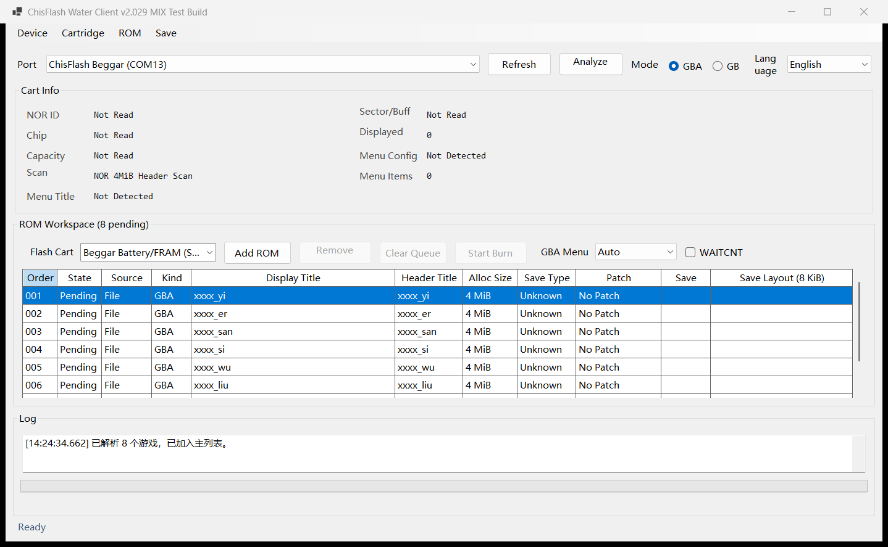
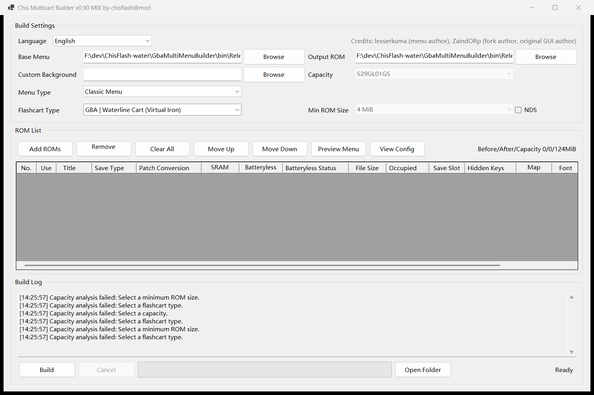
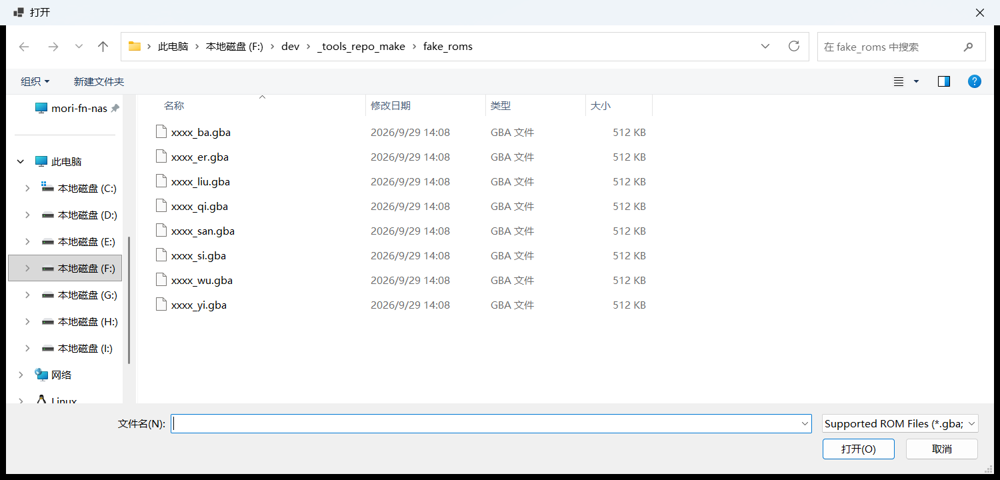
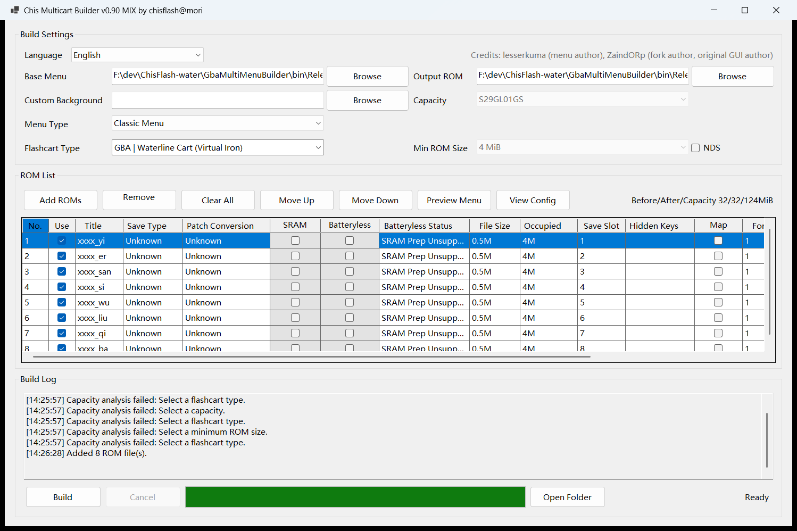

# ChisFlash Tools — User Guide (English)

The repository holds two programs. **They are independent — just pick the one you need.**

## 🔥 Client `ChisFlashWaterClient` (recommended)

**Talk to the cartridge directly and change it however you like.** Pick the flashcart
type and everything else is automatic:

- **Add or remove any game** — games already on the cart can be added or deleted freely, independently of each other
- **Update freely** — swap games, menus or backgrounds; rewrite any time, no full rebuild
- **Export saves freely** — each game's save can be exported / imported on its own
- **Automatic patching** — **no manual steps**; SRAM / batteryless patches are chosen and applied automatically from the flashcart type

## 📦 Builder `GbaMultiMenuBuilder`

**Build multiple games into one multicart ROM file offline**, then flash it with **any**
GBA burner. Suits traditional burners, or when you want a finished file up front.

中文版: [TUTORIAL.zh-CN.md](TUTORIAL.zh-CN.md)

---

## Quick start (Client only)

1. [Install the .NET 9 runtime](#1-prerequisites) (skip [Part 1](#part-1-build) if you don't want to build from source)
2. Plug in the Beggar burner over USB
3. Open the Client → **pick the port** → **pick the mode (GBA/GB)** → **pick the flashcart type**
4. Add games → **Start Burn** (patches are applied automatically)

---

## Contents

- 📦 **Part 1: Build** (collapsed — [click to expand](#part-1-build)) ← skip this if you only want to *use* the tools
  - [1. Prerequisites](#1-prerequisites)
  - [2. Getting the source](#2-getting-the-source)
  - [3. Building](#3-building)
  - [4. Running](#4-running)
  - [5. Build troubleshooting](#5-build-troubleshooting)
- 🔧 [Hardware setup](#hardware-setup)
- 🔥 [Using the Client](#using-the-client)
  - [1. Client interface areas](#1-client-interface-areas)
  - [2. Connect](#2-connect)
  - [3. Add games and burn](#3-add-games-and-burn)
  - [4. Saves](#4-saves)
- 📦 [Using the Builder](#using-the-builder)
  - [1. Builder interface areas](#1-builder-interface-areas)
  - [2. Builder files you must supply yourself](#2-builder-files-you-must-supply-yourself)
  - [3. Steps](#3-steps)
  - [4. Other features and capacity overflow](#4-other-features-and-capacity-overflow)
- 🔬 [Advanced operations](#advanced-operations)
- ⚠️ [Precautions](#precautions)
- 📚 [Appendix: Quick reference](#appendix-quick-reference)

---

<details>
<summary><b>📦 Part 1: Build — click to expand / collapse</b></summary>

<a id="part-1-build"></a>
<a id="第一部分编译"></a>

## 1. Prerequisites

### 1. Required: .NET 9 SDK

Both programs are **.NET 9 + WinForms** projects. They can only be built and run on **Windows**.

Download: https://dotnet.microsoft.com/download/dotnet/9.0

Pick the **.NET 9.0 SDK** (SDK, not Runtime — the SDK includes the compiler), **Windows x64**.

Verify after installation:

```bash
dotnet --version
```

**Expected output**: `9.x.xxx` (anything starting with 9)

If you get "command not found", the installer did not add it to PATH. Re-run the installer with that option checked, or restart your terminal.

### 2. Optional: Visual Studio

If you prefer a GUI over the command line, install **Visual Studio 2022 (17.12 or newer)** and select:

- The **.NET desktop development** workload

This gives you both the `dotnet` command and a graphical build environment.

### 3. Optional: Git

For cloning the repository: https://git-scm.com/download/win

If you would rather not install Git, you can also use **Code → Download ZIP** on the GitHub page.

---

## 2. Getting the source

### 1. Clone (recommended)

```bash
git clone https://github.com/moribaka/ChisFlash-Tools-Exp.git
cd ChisFlash-Tools-Exp
```

### 2. Download ZIP

Click **Code → Download ZIP** on the repository page, then extract anywhere.

### 3. ⚠️ Do not change the directory layout

After cloning or extracting, the directory **must** look exactly like this:

```
ChisFlash-Tools-Exp/
├── ChisFlashWaterClient/     ← Client
└── GbaMultiMenuBuilder/      ← Builder
```

**Both folders must sit side by side under the same parent folder, and their names must not change.**

**Why?** When building, the Client reads **29 source files** from the sibling `GbaMultiMenuBuilder` folder (see the `Include="..\GbaMultiMenuBuilder\..."` entries in `ChisFlashWaterClient.csproj`).

That `..\` means "one level up" — it is a **relative path**. Therefore:

- ✅ Both folders side by side → found, build succeeds
- ❌ Move one folder elsewhere → not found, build fails with "file not found"
- ❌ Rename either folder → same failure

**Even if you only want to build one program**, you must keep both folders intact. You cannot download just one.

---

## 3. Building

### 1. Build both programs

Open a terminal (Command Prompt / PowerShell) in the `ChisFlash-Tools-Exp` directory and run:

**Build the Client:**

```bash
dotnet build ChisFlashWaterClient/ChisFlashWaterClient.csproj -c Release
```

**Build the Builder:**

```bash
dotnet build GbaMultiMenuBuilder/GbaMultiMenuBuilder.csproj -c Release
```

**The first build downloads NuGet dependencies** and takes a few minutes. Subsequent builds are much faster.

A successful build ends with something like:

```
Build succeeded.
    0 Warning(s)
    0 Error(s)
```

### 2. Build output location

| Program | Output path |
|---|---|
| Client | `ChisFlashWaterClient/bin/Release/net9.0-windows/ChisFlashWaterClient.exe` |
| Builder | `GbaMultiMenuBuilder/bin/Release/net9.0-windows/Chis合卡制作器.exe` |

### 3. Building with Visual Studio (alternative)

1. Double-click `ChisFlashWaterClient/ChisFlashWaterClient.sln` or `GbaMultiMenuBuilder/GbaMultiMenuBuilder.sln`
2. Switch the configuration dropdown from `Debug` to `Release`
3. Menu **Build → Build Solution** (or press `Ctrl+Shift+B`)

---

## 4. Running

### 1. Run the build output directly

Go to the output folder and double-click the `.exe`:

```bash
## Client
ChisFlashWaterClient/bin/Release/net9.0-windows/ChisFlashWaterClient.exe

## Builder
GbaMultiMenuBuilder/bin/Release/net9.0-windows/Chis合卡制作器.exe
```

### 2. Packaging into a standalone folder (publish)

To hand the program to someone else, use the `publish` command:

```bash
## Client (framework-dependent, small — target machine needs .NET 9 Desktop Runtime)
dotnet publish ChisFlashWaterClient/ChisFlashWaterClient.csproj -c Release -r win-x64 -o dist/client

## Builder
dotnet publish GbaMultiMenuBuilder/GbaMultiMenuBuilder.csproj -c Release -r win-x64 -o dist/builder
```

The output folders (`dist/client`, `dist/builder`) contain a complete distributable program. Copy the whole folder.

**Default is "framework-dependent"**: small (tens of MB), but the target machine must have the .NET 9 Desktop Runtime installed.

To make it **run anywhere with no runtime dependency**, add `--self-contained true`:

```bash
dotnet publish ChisFlashWaterClient/ChisFlashWaterClient.csproj -c Release -r win-x64 --self-contained true -o dist/client-standalone
```

The trade-off is size — it grows past 100 MB, so it is generally not recommended.

### 3. Files the programs need at runtime

**Client** needs these next to the executable:

- `Languages/` folder (UI language files)
- `Assets/` folder (menu ROM resources)
- `save_types.ini` (save-type detection rules)
- `covers/` folder (**optional** — game cover library; missing only disables cover display)

**Builder** needs these next to the executable:

- `Languages/` folder
- `Assets/` folder (including `Fonts/`)
- `save_types.ini`, `save_type_overrides.ini`

`dotnet publish` copies all of these automatically — no manual copying needed.

---

## 5. Build troubleshooting

### "Could not find ../GbaMultiMenuBuilder/..."

**Cause**: Wrong directory layout — the two folders are not side by side.

**Fix**: Make sure `ChisFlashWaterClient` and `GbaMultiMenuBuilder` are under the same parent directory with exactly matching names (watch the casing).

### "The current .NET SDK does not support targeting .NET 9.0"

**Cause**: .NET 9 SDK is not installed, or an older version is.

**Fix**: Run `dotnet --list-sdks` to list installed versions. Make sure one starts with `9.`. If not, install it from the official site.

### Builds fine but the app crashes on launch

**Cause**: Usually missing runtime files (e.g. `Languages/`).

**Fix**: Run from the entire `bin/Release/net9.0-windows/` folder. Do not copy just the `.exe` out on its own.

### NuGet download times out / stuck on "Restoring"

**Cause**: Unstable connection to nuget.org.

**Fix**: Configure a local NuGet mirror, or check your proxy settings.

### Antivirus flags or deletes the .exe

**Cause**: Self-compiled unsigned executables are commonly false-flagged.

**Fix**: Add an exclusion for the folder, or temporarily disable real-time protection.

</details>

## Hardware setup

### 1. What you need

| Item | Notes |
|---|---|
| **Burner** | A ChisFlash-series burner (Beggar), connected over USB |
| **Cartridge** | A flashable ChisFlash cart — see the table below |
| **USB cable** | Connects the burner to the PC |

#### Supported cart models and capacities

| Cart | Supported capacity |
|---|---|
| **ChisFlash 1.0G** | **128 MiB** (01G) / **256 MiB** (02G) |
| **ChisFlash WaterLink** | **128 MiB (01G)** / **256 MiB (02G)** |
| **ChisFlash MAX/MBCX** (free-multicart firmware) | **32 MiB NOR** + **512 KiB SRAM** |

### 2. Files you must supply yourself

The repository ships **the software only** — no games and no artwork. Only one item is strictly required:

| Item | Required? | Notes |
|---|---|---|
| **Game ROMs** | ✅ Yes | `.gba` game files (or `.zip`). No substitute — you must have these |
| **Base menu** | ⚙️ Optional | The Builder bundles default menus under `Assets/` and selects one automatically |
| **Covers / background** | ⭕ Optional | Cosmetic only — the cart still builds and flashes without them |
| **CJK font** | ⭕ Optional | Needed only for GBC Chinese menus |

### 3. Detecting the device

Plug the burner into the PC with a USB cable, then **open the Client**:

1. Click **Refresh** (or just open the app — it scans automatically)
2. In the **Port** dropdown, pick the entry that shows the **burner's name** — e.g. `ChisFlash Beggar`, `ChisFlash WaterLink`
3. It is detected automatically once selected

---

## Using the Client

Talk to the cartridge directly — **no multicart file needed first**. Once the flashcart
type is set, patches, mapping and save slots are all handled automatically.

### 1. Client interface areas



| Area | Contents |
|---|---|
| **Top toolbar** | Port selection, Refresh, Scan cartridge, Mode (GBA/GB), function menus |
| **ROM workspace** | Burn queue |
| **Cartridge ROM list** | Games already on the cartridge |
| **Log** | Operation history and errors |

The Client ships its own menu ROMs under the **`Assets\` folder next to the program** (`lk_multimenu.gba`, `wl_magic_menu.gba`, `universal_menu.gba`, `simplified_ns_menu.gba`, …). The release package already includes them — **nothing to prepare**. To swap in your own menu, see [Advanced operations · Menu operations](#1-menu-operations).

### 2. Connect

1. **Port** → pick the entry showing the **burner's name** (e.g. `ChisFlash Beggar`); click **Refresh** if missing
2. **Mode** → `GBA` or `GB`, matching your cartridge
3. **Flashcart type** → match your actual cart (a wrong choice patches the wrong way)
4. Click **Scan cartridge** → games on the cart appear in **Cartridge ROM list**

### 3. Add games and burn

- In the **ROM workspace** click **Add ROM** and pick `.gba` files (multiple allowed)
- Click **Start burning** — **do not unplug or close the window during the process**
- Afterwards, scan the cartridge again to confirm the games are on it

### 4. Saves

| Feature | Notes |
|---|---|
| **Export / Import save** | Export one game's save to `.sav`, or write it back |
| **Export / Import chip save** | Read or write the flash chip's save area directly |
| **Clear save** | Erase the save data on the cartridge |

---
## Using the Builder

**Goal**: pack multiple `.gba` games into a **single** multicart ROM file, built offline
ahead of time. The resulting file can be flashed with **any** GBA burner — this route
suits traditional burners.

### 1. Builder interface areas

After launching, the window has three main sections:



| Area | Contents |
|---|---|
| **Build settings** | Base menu, output ROM, custom background, cover directory, CJK font, capacity, flashcart type, menu type |
| **ROM list** | Add games, reorder, assign save slots |
| **Build log** | Progress and results |

### 2. Builder files you must supply yourself

The repository ships **the program only** — no games, covers, or menu artwork. These items need to come from you:

| Item | Required? | What you need | How to set it |
|---|---|---|---|
| **Game ROMs** | ✅ Yes | `.gba` or `.zip` game files | Click **Add ROMs**, or drag them into the list (any location) |
| **Base menu** | ⚙️ Optional | Menu kernel ROM (`.gba`) | The **`Assets\` folder next to the program** — see below |
| **Cover directory** | ⭕ Optional | `cover_index.csv` + cover images | Pick the folder via **Browse** next to **Cover directory** |
| **Custom background** | ⭕ Optional | A background image of the required size | Pick the image via **Browse** next to **Custom background** |
| **CJK font** | ⭕ Optional | GBC Chinese bitmap font | Pick it via **Browse** next to **CJK font** (usually not needed for GBA) |

**Where the base menu goes**: the **`Assets\` folder next to the program**, with fixed file names — picked automatically from the *menu type* + *flashcart type*:

| Menu type | Flashcart type | File name |
|---|---|---|
| Classic menu | Normal / no battery | `lk_multimenu.gba` |
| Classic menu | Waterline (virtual FRAM) | `lk_multimenu_wl.gba` |
| NS menu | **Any** (all supported) | `universal_menu.gba` |
| Simplified NS menu | **Any** (all supported) | `simplified_ns_menu.gba` |

The shipped package already contains all four — **nothing to prepare**. Only replace them if you want to use a self-built menu: drop the file into `Assets\` under the matching name above.

### 3. Steps

**① Set parameters** (⬅️ must match the physical cartridge)

| Option | Notes |
|---|---|
| **Capacity** | GBA side: **01G (128 MiB)** / **02G (256 MiB)**; GBC side: **32 / 128 / 256 MiB**. Must match the physical cartridge |
| **Flashcart type** | `GBA \| 01G/02G (battery/FRAM)`, `GBA \| 01G/02G (no battery)`, `GBA \| Waterline (virtual FRAM)`, `GBC \| MAX/MBCX (512K)` |
| **Menu type** | `Classic menu` / `NS menu` / `Simplified NS menu` |
| **Base menu** | **Usually leave alone** — uses the default menu in the program's `Assets\` folder, switched automatically with *menu type* / *flashcart type* |
| **Output ROM** | Where to write the generated file (e.g. `output/my-multicart.gba`) |

**② Add games** (⬅️ requires your own `.gba` files)

- Click **Add ROMs**, or **drag and drop** `.gba` files in; multi-select, whole folders, and `.zip` extraction all work
- Use **Move up / Move down** to reorder the menu, **Remove selected** to drop games, **Auto save slots** to assign SRAM



**③ Build**

- Click **Start build**, watch the **Build log** until it reports success, then **Open output folder**



**④ (optional) Set up covers** (⬅️ requires your own cover images and `cover_index.csv`)

- **Cover directory** → point at the folder of cover `.png` files → **Auto match** pairs them by filename

### 4. Other features and capacity overflow

| Feature | Notes |
|---|---|
| **Split into 32 MiB parts** | Splits a very large cart into multiple files |
| **Apply SRAM patch** | Patches games to work with SRAM saves |
| **Preview menu** | Preview the menu display before building |
| **View config** | Inspect capacity usage and configuration details |
| **Export font** | Export the CJK bitmap font |

When the build log shows an **"over capacity"** message: reduce the number of games, or
use a larger cartridge. The **"before patch / after patch / capacity"** figures in the log
help pinpoint the cause (some games change size after patching).

---

## Advanced operations

These live under the **Cartridge** / **ROM** / **Save** menus. **They carry risk — back up your saves first.**

### 1. Menu operations

| Feature | Notes |
|---|---|
| **Update menu** | Update the cart menu to the current bundled menu ROM |
| **Rebuild menu** | Force a menu rebuild (for display problems) |
| **Rebuild with a specified menu file** | Opens a file dialog to pick a `.gba` menu ROM (any location) and uses it to replace the cartridge's menu |
| **Repair menu** | Fix a corrupted menu directory / metadata |
| **Repair Magic metadata** | Fix the WL (WaterLink) mapping |
| **Upgrade to Magic mode** | Convert an old menu to Magic management |
| **Update background image** | Replace the menu background (240×160 PNG, ≤256 colors) |
| **Erase config** | Clear the menu config area (games are preserved) |

### 2. Chip operations

| Feature | Notes |
|---|---|
| **Detect Magic metadata** | Check whether the cart uses Magic-management format |
| **Unlock PPB** | Remove flash PPB write protection (needed for some locked chips) |
| **Erase entire NOR** | ⚠️ **Wipes the whole NOR — all data including games is gone** |
| **Fragment test** | Test the fragment management feature |
| **Timing settings** | View current NOR read/write timing parameters |

---

## Precautions

### 1. Data safety

- **Losing power or unplugging mid-flash can leave a cartridge half-written**, requiring a full erase and retry
- **Do not close the Client window while flashing**
- Before working on an important cartridge, use **Export save** to back it up
- Before erasing the entire NOR, use **Export ROM** to back up the games

### 2. Matching parameters

- The Builder's **capacity and flashcart type** must match the physical cartridge
- The Client's **mode (GBA / GB)** must match the cartridge type
- Timing parameters differ per chip; if reads or writes are unstable, try **Timing settings**

### 3. Game compatibility

- Not every game works in a multicart — some use unusual mappers or save mechanisms
- Batteryless patching is not universal across all flash chip models
- A successful build does not guarantee every game plays through; test them individually

### 4. Version pairing

**The Builder and the Client must be used as a matched pair**, because they share source code.

- Both version numbers are visible in the window title bar or the About dialog
- A large version gap may produce multicarts the Client cannot handle correctly

---

## Appendix: Quick reference

### Files you must supply

| File | Required? | Can you skip it? |
|---|---|---|
| Game ROMs (`.gba` / `.zip`) | ✅ Yes | ❌ No — without games there is nothing to pack |
| Base menu ROM | ⚙️ Optional | ✅ Yes — the bundled one under `Assets/` is used |
| Covers + `cover_index.csv` | ⭕ Optional | ✅ Yes — the menu simply has no covers |
| Custom background image | ⭕ Optional | ✅ Yes — the default background is used |
| GBC CJK font | ⭕ Optional | ✅ Yes (the GBA flow never needs it) |

### Two routes at a glance

**A. Client route (recommended — change things as you go)**

```
1. Build (or use an existing exe)
   dotnet build ChisFlashWaterClient/ChisFlashWaterClient.csproj -c Release

2. Plug in the burner → launch the Client → pick port → mode → flashcart type → Scan cartridge

3. Add ROMs → Start burning (patches applied automatically)

4. To change things: delete games in the cart list, add new ones, re-burn any time —
   no need to rebuild a whole multicart
```

**B. Builder route (offline file, for traditional burners)**

```
1. Build
   dotnet build GbaMultiMenuBuilder/GbaMultiMenuBuilder.csproj -c Release

2. Launch the Builder → pick base menu + cartridge params → add games → Start build
   → produces output/my-multicart.gba

3. Flash that .gba with any GBA burner
```

### Directory cheat sheet

```
ChisFlash-Tools-Exp/
├── ChisFlashWaterClient/         Client
│   ├── ChisFlashWaterClient.sln
│   ├── Languages/                UI languages
│   ├── Assets/                   ★ the Client's menu ROMs (bundled)
│   │   ├── lk_multimenu.gba        Classic menu
│   │   ├── wl_magic_menu.gba       Classic menu (Waterline)
│   │   ├── universal_menu.gba      NS menu
│   │   ├── simplified_ns_menu.gba  Simplified NS menu
│   │   └── menu_zh.gb / menu_en.gb GBC menu
│   └── covers/                   cover library (not shipped)
└── GbaMultiMenuBuilder/          Builder
    ├── GbaMultiMenuBuilder.sln
    ├── Fc/                       FC (NES) cartridge support
    ├── Md/                       MD cartridge support
    ├── Languages/                UI languages
    └── Assets/                   ★ the Builder's menu ROMs (bundled)
        ├── lk_multimenu.gba        Classic menu
        ├── lk_multimenu_wl.gba     Classic menu (Waterline)
        ├── universal_menu.gba      NS menu
        ├── simplified_ns_menu.gba  Simplified NS menu
        ├── menu_zh.gb / menu_en.gb GBC menu
        └── Fonts/                  fonts
```

Each program keeps its **own, independent** menu files under its own `Assets\` folder; the release package already includes them.

### Third-party assets

- `GbaMultiMenuBuilder/Fc/MesenNesDB.csv` comes from [Mesen2](https://github.com/SourMesen/Mesen2); the license text is retained in `Fc/Mesen-LICENSE` (GPL v3)
- Fonts under `GbaMultiMenuBuilder/Assets/Fonts/` are copyright their respective authors
