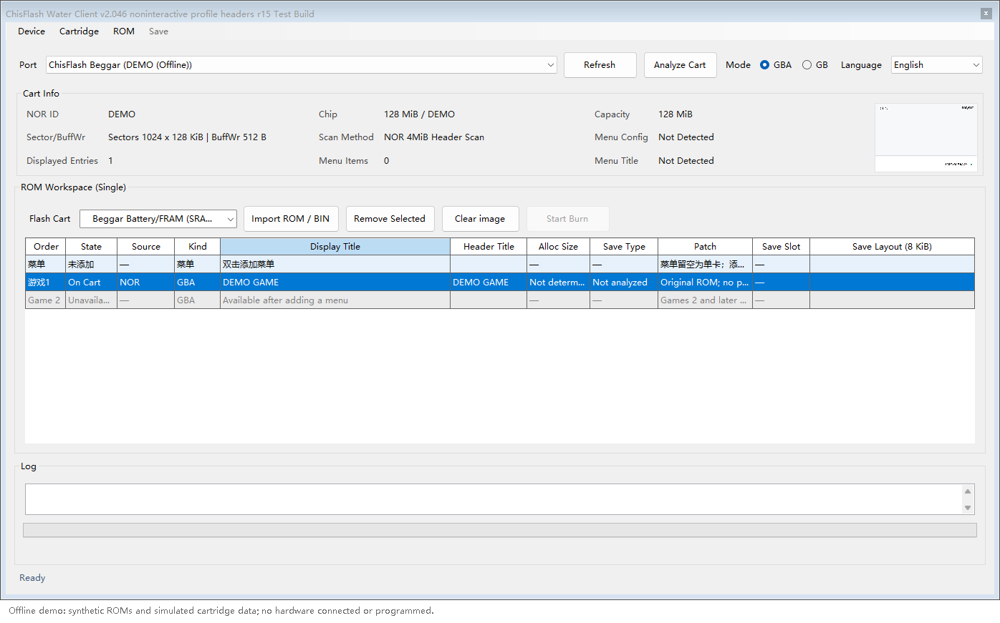
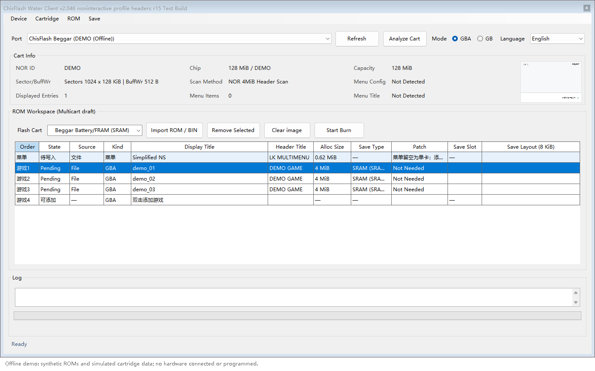
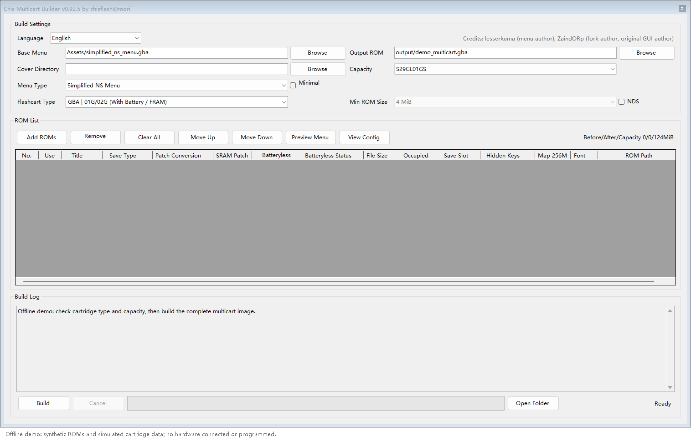

# ChisFlash Tools User Guide

**Client 2.046 r15 / Builder 0.92.5** · [简体中文](TUTORIAL.zh-CN.md)

## 1. Download and preparation

Download the [Windows x64 application package you need](https://github.com/ChisLightyear/ChisFlash-Tools-Exp/releases/tag/v2.046-r15-0.92.5) and extract the whole folder. The repository and downloads are public. Tutorials, screenshots and source stay in the repository; application packages contain compiled programs and required runtime files.

- `ChisFlashWaterClient.exe`: Client for a compatible Beggar programmer or explicitly identified WaterLink.
- `Chis合卡制作器.exe`: offline Builder; write its complete images with a compatible programmer.

The package includes the .NET runtime. Keep the DLLs, `Languages`, `Assets` and rule files alongside each executable. Supply your cartridge, programmer, USB data cable and game ROMs. Export any existing ROMs and saves you need to keep before changing a cartridge.

Covers and backgrounds are optional and are not bundled. Chinese GBC menus need a user-supplied 12px font in the tool's `Assets/Fonts/`; English menus use built-in glyphs. MIX titles currently require the user-provided `Assets/Fonts/mplus_hzk_12.ttf`.

## 2. Connect and identify

1. Refresh and select the serial port.
2. Choose `GBA` or `GB` to match the cartridge.
3. Use `Analyze Cart` to inspect NOR capacity and contents. On large GBA cartridges this scans game headers; use the configuration-analysis action for directory, mapping and save details.
4. Select the actual cartridge configuration under `Flash Cart`.

GBA/GB controls stay visible. An explicitly identified WaterLink forces GBA and disables switching. Generic AG32/CDC names are not treated as WaterLink. For other ports, GBA/GB selects the command mode; it does not prove which firmware is installed.



## 3. GBA single-game workflow

The profile selector groups multicart and single-game profiles. Group headings cannot be clicked. Single-game choices include generic cartridges, ChisFlash 1.0, 1.1 without/with RTC, 1.2 and 1.0V. The unconfirmed 1.1V entry is disabled. NOR identity does not identify save hardware or RTC capabilities.

Recognized 256 Mbit NOR models with a measured 32 MiB capacity show only single-game choices and Game 1. Import or replace the ROM, review it and start programming. The original ROM is written from address zero without automatically adding a menu or SRAM/batteryless patch. Newly listed models use this raw-ROM flow; no new FLASH-ID, RTC or RTS patches are implied.

Clearing the workspace changes the local draft; it does not erase the cartridge. A header-only scan cannot determine the ROM's full length. Supply the requested export length instead of assuming it equals NOR capacity.

## 4. GBA multicart workflow

For a multicart-capable cartridge:

1. Add or select a menu in the menu row. Simplified NS is the default; Classic and full NS are explicit alternatives.
2. Without a menu, only Game 1 is available. Adding a menu opens further game rows.
3. Import your ROMs and check ordering, space, saves, patches and optional covers. Import/replace/remove operations edit a draft.
4. When converting an existing single game, explicitly choose whether to keep it and provide its read length when asked.
5. Start programming and confirm the operation. Keep power and USB connected until completion.
6. Rescan and test game startup, saving and reload after a power cycle on the console.



A menu cannot be removed while multiple games remain. A preview marked as pending has not been written. GBA/CHM1/WaterLink writes retain protocol acknowledgements and completion waits without reintroducing the removed byte-for-byte post-write comparison. GB/GBC full-image and full-erase workflows keep their separate verification rules.

## 5. GB/GBC profiles

Choose GB, detect NOR, then select the cartridge configuration. Capacity filters candidates; it does not choose firmware.

| NOR | Profile | Layout |
|---|---|---|
| 8 MiB | MBC5 3in1 / 4in1 | Menu plus four game slots; Game 3 above 2 MiB occupies Game 4 space |
| 8 MiB | MBCX RTC 8M | One GB/GBC game, at most 2 MiB |
| 32 MiB | MBC5 MAX 16in1 | Menu plus sixteen games; Game 1 at most 1 MiB, others 2 MiB each |
| 32 MiB | MBCX RTC 32M | One GB/GBC game, at most 2 MiB |
| 32 MiB | Free multicart · MAX/MBCX 32M | Matching free-multicart firmware, menu, directory and saves |
| 32 MiB | MIX · NES / MD / SNES | Matching MIX firmware and workspace |

See the [GBC free-multicart guide](https://github.com/ChisLightyear/ChisFlash-GBC-FreeMulticart/blob/main/TUTORIAL.en.md):

- Beggar + Client: erase all NOR, install the menu, add games and program.
- Another compatible programmer + Builder: build a complete ROM, erase NOR, then write the complete image.

Full NOR erase removes menus, directories and games, but does not erase the separate GB/GBC SRAM chip. Fixed-slot, RTC and free-multicart layouts are different; do not interchange their menus or images.

## 6. MIX

Select MIX and import supported NES, MD, SNES or ZIP files. Review the games, ROM/SRAM space and titles before exporting BIN or programming.

NES/MD/SNES share allocators and support noncontiguous SRAM banks. The tools use GLB2 v2 / LNC2 v2 only; retired formats are not read or automatically migrated. Full-title and launch-sequence extensions require matching firmware. Successful import or packing does not establish hardware gameplay compatibility.

Technical references: [storage contract](docs/MIX-V2-STORAGE-CONTRACT.md), [full titles](docs/MIX-FULL-TITLES.md), [launch sequence](docs/MIX-LAUNCH-SEQUENCE.md).

## 7. Builder



1. Select platform, actual cartridge type and capacity. Default menu binaries are included in `Assets/`.
2. Choose an output file, add ROMs, and adjust titles, ordering, saves and patch options.
3. Optionally configure covers/backgrounds. Chinese GBC menus also need your own 12px font.
4. Preview, check space and start building.
5. Confirm success and that no games were unexpectedly skipped. Write the resulting complete image with a compatible programmer; the Builder itself does not flash hardware.


All screenshots come from these versions and use synthetic ROMs or simulated scan data. No cartridge was connected or programmed during capture. Some recent controls retain Chinese labels in the current English UI.

## 8. Saves and updates

Select a game and use the save import/export actions supported by that mode. When moving to another cartridge, establish its game layout before restoring matching saves. Dedicated save space does not provide power-off retention by itself; that depends on the hardware.

For a menu update that preserves games, answer No to clearing configuration. If a directory is damaged or the layout must change, back up before rebuilding. Removing a draft entry, clearing an image, clearing configuration and erasing all NOR are different operations.

## 9. Build from source

Use Windows with .NET 9 SDK or a newer SDK supporting `net9.0-windows`. Keep `ChisFlashWaterClient/` and `GbaMultiMenuBuilder/` side by side; the Client links shared Builder code.

```powershell
dotnet build ChisFlashWaterClient/ChisFlashWaterClient.csproj -c Release
dotnet build GbaMultiMenuBuilder/GbaMultiMenuBuilder.csproj -c Release
```

Outputs are under each project's `bin/Release/net9.0-windows/`. Initial builds restore NuGet packages. Menu/patch resources are in the repository; no developer-drive paths, GBDK, Quartus or external menu source trees are required.

```powershell
dotnet publish ChisFlashWaterClient/ChisFlashWaterClient.csproj -c Release -r win-x64 --self-contained true -o dist/client
dotnet publish GbaMultiMenuBuilder/GbaMultiMenuBuilder.csproj -c Release -r win-x64 --self-contained true -o dist/builder
```

Supply fonts/covers separately.
