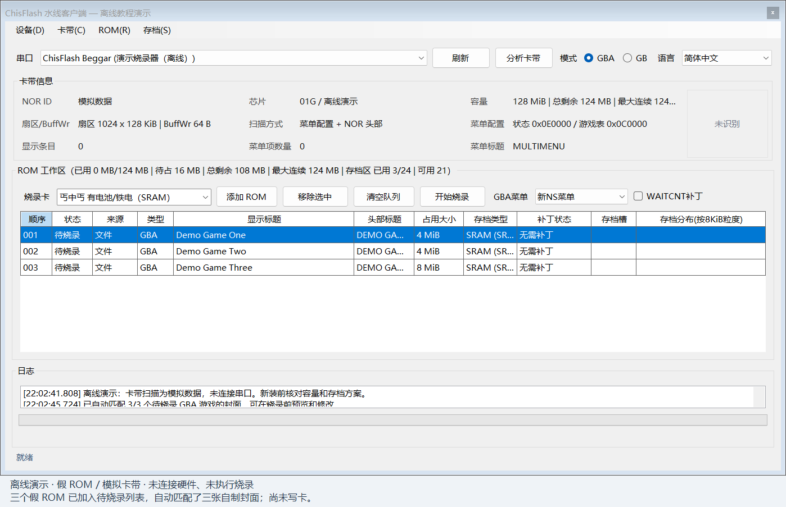
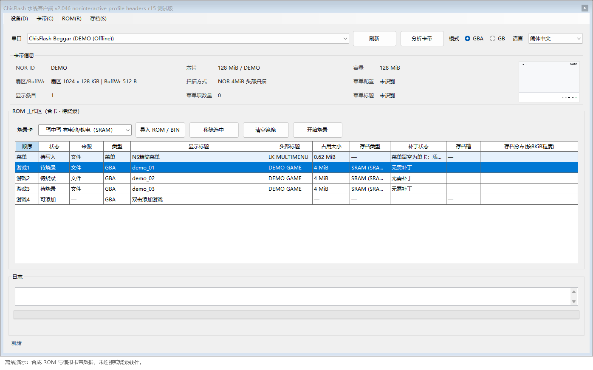
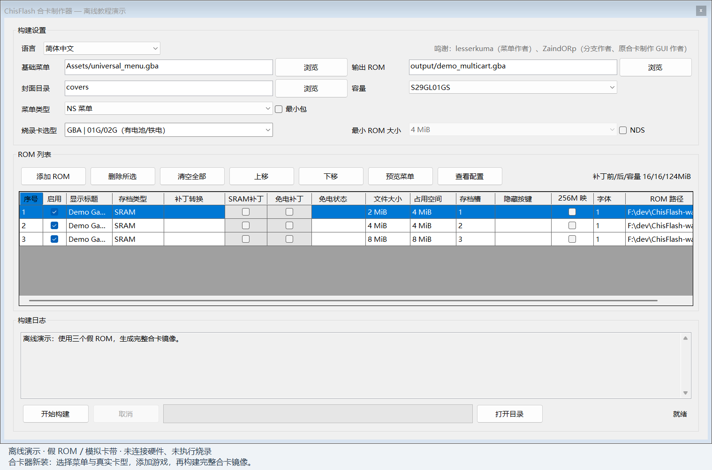
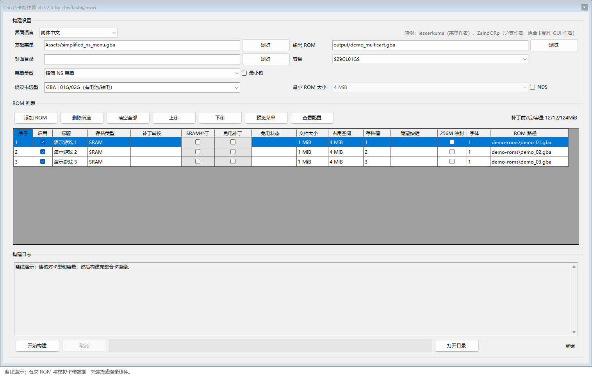

# ChisFlash 工具集使用教程

**上位机 2.046 r15 / 合卡器 0.92.5** · [English](TUTORIAL.en.md)

## 1. 下载与准备

下载[所需的程序包](https://github.com/ChisLightyear/ChisFlash-Tools-Exp/releases/tag/v2.046-r15-0.92.5)，解压整个文件夹：

- `ChisFlashWaterClient.exe`：上位机，配合丐中丐或已明确识别的 WaterLink 使用。
- `Chis合卡制作器.exe`：合卡器，离线生成镜像，交给兼容烧录器完整写入。
- 教程、截图和版本说明在仓库中查看，源码可通过 GitHub 的 Code → Download ZIP 获取。

本次 Windows x64 包自带 .NET 运行时，无需另装运行时。不要只复制 EXE，保留同目录的 DLL、`Languages`、`Assets` 和配置规则文件。程序包只包含已编译程序、必需运行文件和许可说明。

准备好匹配的卡带、烧录器、USB 数据线和自备的 ROM。旧卡上需要保留的 ROM 和存档先导出备份。

| 可选资源 | 放置方式 |
|---|---|
| GBA 封面 | 在工具里选择自己的封面目录及索引，不随包附带 |
| GBC 中文字库 | 自备 12px 字库，放入所用工具的 `Assets/Fonts/`，重新打开工具后选择；英文菜单不需要 |
| MIX 标题字库 | 当前使用 `Assets/Fonts/mplus_hzk_12.ttf`，需自行提供 |
| 自定义菜单背景 | 在支持该功能的菜单预览或构建设置中选择图片 |

## 2. 连接与识别

1. 打开上位机，刷新并选择串口。
2. 按实际卡带选择 `GBA` 或 `GB`。
3. 点击 `分析卡带`，核对 NOR 容量和内容。GBA 大容量卡的该操作主要扫描游戏头；需要菜单目录、映射和存档布局时使用 `分析配置`。
4. 在 `烧录卡` 中选择与卡带及固件一致的具体类型。

`GBA/GB` 选框始终显示。明确识别为 WaterLink 时固定选择 GBA 并置灰；通用 AG32/CDC 名称不会自动认作 WaterLink。其他串口的 GBA/GB 是用户指定的通信模式，不代表程序已经识别出卡带固件。



## 3. GBA 单卡

烧录卡列表分为“——合卡——／——单卡——”，标题不能点击。单卡类型包括通用单卡、ChisFlash 1.0、1.1 无时钟／时钟、1.2 及 1.0V；待确认的 1.1V 不可选。具体存档硬件和 RTC 不能仅由 NOR 型号推断。

- 已收录的 256 Mbit NOR 且实际容量为 32 MiB 时，仅提供单卡类型和游戏1。
- 在游戏1导入或替换 ROM，核对内容后点击 `开始烧录`。原 ROM 从地址0写入，不自动添加合卡菜单或 SRAM／免电补丁。
- 清空工作区只清除本地待写内容，不等于擦除实卡。
- 扫描只读到头部时，不能把整卡容量当作游戏大小；导出按提示指定长度。
- 新列出的单卡型号沿用原 ROM 流程，不代表已经添加各型号的 FLASH ID、RTC 或 RTS 专用补丁。

## 4. GBA 合卡

仅用于支持合卡的卡型：

1. 在菜单行选择或导入菜单；默认 NS 精简，也可明确选择经典或完整 NS。
2. 没有菜单时只开放游戏1，后续游戏行禁用；加入菜单后开放后续游戏。
3. 导入自备 ROM，检查顺序、容量、存档类型、补丁和封面。导入、替换、移除都是草稿操作。
4. 旧单游戏转合卡时，如需保留卡内游戏，按提示明确读取长度；不要直接覆盖旧游戏。
5. 点击 `开始烧录`，确认提示并等待完成。过程中不要拔线、断电或关闭程序。
6. 重新分析内容，并在掌机上检查启动、保存和重启读档。



有多个游戏时不能移除菜单。菜单预览中“待写入”的内容尚未写到卡带。普通 GBA、CHM1 和水线的写入保留相应 ACK／完成等待，不额外执行已取消的写后逐字节比较；GB/GBC 的完整镜像及全擦流程仍按各自规则校验。

## 5. GB/GBC 选型

先选择 `GB` 并分析 NOR，再明确选型。容量只缩小候选范围，不能判断当前刷的固件。

| NOR 容量 | 可选模式 | 要点 |
|---|---|---|
| 8 MiB | MBC5 3in1 / 4in1 | 菜单＋游戏1～4；游戏3超过2 MiB会占用游戏4空间 |
| 8 MiB | MBCX RTC 8M | 单个 GB/GBC 游戏，最大2 MiB |
| 32 MiB | MBC5 MAX 16in1 | 菜单＋16游戏；游戏1最大1 MiB，其余各2 MiB |
| 32 MiB | MBCX RTC 32M | 单个 GB/GBC 游戏，最大2 MiB |
| 32 MiB | 自由合卡 · MAX/MBCX 32M | 配套自由合卡固件、目录、菜单及独立存档 |
| 32 MiB | MIX · NES / MD / SNES | 使用配套 MIX 固件和工作区，与 GBC 自由合卡分开 |

GBC 自由合卡的两条完整流程见[独立教程](https://github.com/ChisLightyear/ChisFlash-GBC-FreeMulticart/blob/main/TUTORIAL.zh-CN.md)：

- 丐中丐＋上位机：全擦 NOR → 安装菜单 → 加游戏 → 烧录。
- gbflash 等兼容烧录器＋合卡器：生成完整 ROM → 全擦 NOR → 完整烧入镜像。

全擦会清除 NOR 中的菜单、目录和游戏；GB/GBC 独立 SRAM 不随 NOR 全擦清除。固定槽位、RTC、自由合卡使用不同布局，不要混用菜单或镜像。

## 6. MIX

选择 `MIX · NES / MD / SNES`，导入自备 `.nes`、MD ROM、`.sfc` / `.smc` 或支持的 ZIP。检查列表、ROM/SRAM 占用和标题后，导出 BIN 或明确执行烧录。

三平台共用 ROM 和 SRAM 分配器，支持非连续 SRAM bank。只使用 GLB2 v2 / LNC2 v2；不读取或自动迁移已废弃旧格式。完整名称和启动序列扩展需要配套固件支持。可导入、可合卡不等于已验证核心能运行该游戏。

详见[统一存储协议](docs/MIX-V2-STORAGE-CONTRACT.md)、[完整名称](docs/MIX-FULL-TITLES.md)和[启动序列](docs/MIX-LAUNCH-SEQUENCE.md)。

## 7. 使用合卡器



1. 选择平台、实际卡型和容量；菜单成品已放在 `Assets/`，通常直接选择菜单类型。
2. 选择输出文件位置，添加 ROM，调整名称、顺序、存档和补丁选项。
3. 封面和背景可选。GBC 中文菜单另外选择自备的 12px 字库。
4. 预览菜单并检查空间；点击 `开始构建`。
5. 确认构建成功且没有意外跳过游戏，再用兼容烧录器写入生成的完整镜像。合卡器本身不烧录实卡。



本页截图全部来自本次程序，使用合成 ROM 和模拟数据，未连接或烧录硬件。

## 8. 存档与更新

在上位机选中游戏后使用存档菜单导出／导入 `.sav`，按当前模式提供的入口操作。换卡时先完成目标卡的游戏布局，再恢复对应游戏存档。独立存档空间不等于断电保持，仍取决于卡带硬件。

保留已有合卡游戏更新菜单时，清除配置提示选择“否”；若目录损坏或要改变布局，先备份再重建。不要把工作区的移除游戏、清空镜像、清配置区与全片擦除当成同一操作。

## 9. 自行编译

Windows 上安装 .NET 9 SDK 或支持该目标框架的更新 SDK。下载完整源码，保持两个项目并排：

```text
ChisFlash-Tools-Exp/
  ChisFlashWaterClient/
  GbaMultiMenuBuilder/
```

在仓库根目录运行：

```powershell
dotnet build ChisFlashWaterClient/ChisFlashWaterClient.csproj -c Release
dotnet build GbaMultiMenuBuilder/GbaMultiMenuBuilder.csproj -c Release
```

程序在各自 `bin/Release/net9.0-windows/`。首次构建需要还原 NuGet 包；菜单及补丁资源已随仓库提供，不依赖开发机的其他工程或盘符。两个目录不能拆开编译上位机。

生成与本次相同形式的独立运行包：

```powershell
dotnet publish ChisFlashWaterClient/ChisFlashWaterClient.csproj -c Release -r win-x64 --self-contained true -o dist/client
dotnet publish GbaMultiMenuBuilder/GbaMultiMenuBuilder.csproj -c Release -r win-x64 --self-contained true -o dist/builder
```

字体和封面由用户另外准备。验证入口见 [tests/README.md](tests/README.md)。
